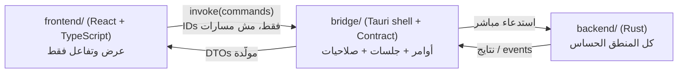

# Sweeper — Implementation Plan

> الحالة: مسودة للمراجعة الأخيرة. لم يبدأ أي كود بعد.
> المصطلحات المستخدمة هنا معرّفة في [GLOSSARY.md](../GLOSSARY.md) (Target, Allowlist, Protected Path, Custom Path, Risk, Tier, Scan, Preview, Clean, Analyzer, Minimum Age, Skipped, Link Point).
> القرارات المعمارية: [ADR 0001](./adr/0001-deny-by-default-allowlist.md)، [ADR 0002](./adr/0002-three-part-separation.md)، [ADR 0003](./adr/0003-handle-based-removal.md).

---

## 1. الهدف والحدود

**الهدف:** تطبيق ويندوز بزرار واحد، يلاقي المساحة اللي ممكن تتحرر على درايف C، ويعرضها بالتفصيل (إيه هي، وحجمها، وخطورتها)، ويمسح بس اللي المستخدم أكّده. **الأمان والسلامة أهم من أي ميزة وأهم من السرعة.**

**داخل v1:**
- Scan + Preview + Clean لـ Targets الطبقات 1 و2 و3 (الطبقة 3 مطفية افتراضيًا).
- Analyzer للقراءة فقط مع شرح كل عنصر وتصنيف الـ Risk، ومنه تقدر تحدد عناصر للمسح.
- Advanced Settings: Custom Paths، تشغيل/إطفاء الـ Tiers، السماح بمسح الـ Unknown، تعديل Minimum Age.
- مسح نهائي (بدون Recycle Bin)، و log لكل عملية.
- واجهة إنجليزي. الـ exe مستقل بدون تثبيت أدمن (UAC) افتراضيًا.

**خارج v1 (صراحةً):**
- ضغط/تقليص ملفات `vhdx` الخاصة بـ WSL وDocker. بنعرضها بس في الـ Analyzer ومفيش حذف لها.
- قراءة الـ MFT مباشرة لتسريع الـ Analyzer (محتاجة أدمن). فكرة لمرحلة لاحقة.
- أي كود بيشتغل في الخلفية أو بجدول زمني. كل عملية بتبدأ بضغطة زرار من المستخدم.
- الواجهة العربية.

---

## 2. المعمارية: ٣ أجزاء منفصلة

الأجزاء التلاتة بتتعدّل وتتختبر لوحدها. الاتصال بينهم كله بـ **Contract** مكتوب بأنواع (types) مولّدة تلقائيًا، فمفيش مكان تتغير فيه حاجة في جزء وتنكسر في التاني من غير ما الـ build يقول.



```text
Sweeper/
├─ Cargo.toml                  workspace واحد يجمع backend + bridge
├─ rust-toolchain.toml         نسخة Rust مثبتة (1.99.1)
├─ clippy.toml  deny.toml      قواعد الـ lint (منع الحذف خارج remover) والـ dependencies
├─ backend/                    ← الجزء 1: Rust بدون أي UI
│  ├─ sweeper-winfs/           عمليات ويندوز الخام (unsafe هنا بس)
│  ├─ sweeper-knowledge/       Allowlist + Protected Paths + Knowledge Base (بيانات + أنواع)
│  ├─ sweeper-core/            المنطق: التحقق، Scan، Analyzer، Remover، Log، Settings
│  └─ sweeper-testkit/         أدوات الاختبار: sandbox، canaries، junction helpers
├─ bridge/                     ← الجزء 2: الوصلة
│  ├─ sweeper-contract/        الـ DTOs والأخطاء والأوامر (مصدر الحقيقة، بيولّد TypeScript)
│  └─ sweeper-desktop/         غلاف Tauri: الأوامر، الجلسات، capabilities، CSP
├─ frontend/                   ← الجزء 3: Vite + React + TypeScript
│  └─ src/contract/            ملفات مولّدة، للقراءة فقط (ممنوع تعديلها يدويًا)
└─ docs/                       الخطة وADRs
```

**اتجاه الاعتماد (لا يُكسر):**
`sweeper-winfs` ← `sweeper-core` → `sweeper-knowledge`
`sweeper-contract` مستقل (بيعرّف DTOs خاصة بيه، والتحويل بيحصل في `sweeper-desktop`).
`sweeper-desktop` → `sweeper-core` + `sweeper-contract`
`frontend` → الـ contract المولّد فقط.

### مسؤولية كل جزء

| الوحدة | مسؤوليتها | قيد صارم |
|---|---|---|
| `sweeper-winfs` | فتح/تعداد/حذف بالـ handle على NTFS، قراءة نوع الـ reparse، `GetFinalPathNameByHandle` | الوحيدة اللي فيها `unsafe` و`windows-sys`. لا تعرف أي حاجة عن الـ Allowlist أو الـ Risk. |
| `sweeper-knowledge` | تعريف الـ Targets والـ Protected Paths كبيانات، و`allowlist.toml` المدموج، ومحلّله | مفيهاش I/O. |
| `sweeper-core` | `paths` (أنواع المسار)، `policy` (التحقق)، `scanner`، `analyzer`، `remover`، `journal` (الـ log)، `settings` | `#![forbid(unsafe_code)]`. **`remover` هو الوحيد المسموح له بالحذف.** |
| `sweeper-contract` | شكل الأوامر والنتايج والأخطاء | أرقام كبيرة (أحجام) تتبعت كـ string/`bigint` موثّق. |
| `sweeper-desktop` | تسجيل الأوامر، تخزين الـ Scan Sessions في الذاكرة، فرض الـ preview token | مفيهوش أي منطق حذف. |
| `frontend` | العرض والتفاعل | ممنوع أي `fs`/`shell` plugin. ما بيعرفش مسار حذف. |

---

## 3. نموذج الأمان (الأهم في الخطة)

> **ملحوظة صادقة:** مفيش برنامج بيحذف ملفات ينفع نوعده بـ "100% مضمون". اللي بنقدر نضمنه هو **طبقات دفاع مستقلة بحيث لازم تفشل كلها مع بعض** عشان يحصل خطأ، وبوابات (gates) بتمنع أي كود ما بيعدّيش عليها من إنه يوصل للـ exe. الخطة دي مصممة على هذا الأساس.

### 3.1 طبقات الدفاع (بالترتيب)

1. **Deny-by-default:** كل حذف لازم يطابق Target في الـ Allowlist أو Custom Path (ADR 0001).
2. **Protected Paths صلبة:** بتغلب على أي حاجة، ومش قابلة للتعطيل من الواجهة.
3. **الأنواع تمنع الغلط (Parse, don't validate):** الـ `remover` ما بيقبلش إلا `ValidatedItem`، ونوع ده مالوش constructor عام. مفيش طريقة تلتف حوله بسلسلة نصية.
4. **الواجهة مش بتبعت مسارات:** بتبعت IDs لعناصر نتيجة Scan الـ Rust حافظها في جلسة. الاستثناء الوحيد هو إضافة Custom Path (والتحقق منه بيتم في Rust).
5. **Preview Token:** أمر Clean بيطلب token أصدره Preview، وهو لمرة واحدة، مربوط بـ hash لقايمة الـ IDs المحددة، وصلاحيته 10 دقايق. من غير Preview مفيش Clean.
6. **إعادة التحقق لحظة الحذف** (Q8): كل عنصر بيتعاد فحصه على الـ handle نفسه: allowlist + Protected + الـ final path جوّا جذر الـ Target + نوع الـ reparse + Minimum Age.
7. **حذف بالـ handle مش بالمسار** (ADR 0003): بيقفل ثغرة TOCTOU اللي اتصلّحت في Rust نفسه (CVE-2022-21658).
8. **حواجز وقت التشغيل:** Clean بيتوقف لو المساحة الفعلية اتمسحت > 120% من المقدّرة في الـ Preview، أو لو ظهر مسار برّه الجذر. وأي `panic` جوّا الـ remover بيوقف العملية كلها (`panic=abort` على الـ crate ده).
9. **Write-ahead journal:** النية بتتكتب وتتعمل flush في الـ log قبل كل batch حذف، فعمرنا ما نفقد أثر اللي حصل حتى لو الـ process اتقتل.

### 3.2 قواعد الـ Targets (مفروضة في الـ build)

- كل مسار = **Known Folder** (من `SHGetKnownFolderPath`، مش متغير بيئة نصي) + مسار نسبي ثابت.
- ممنوع `**`. المسموح `*` واحدة في segment وسطي بس (مثلاً `Profile *`)، وماتكونش آخر segment.
- ممنوع Target جذره بروفايل متصفح: لازم المسار يوصل لـ `Cache` و`Code Cache` و`GPUCache` بالاسم.
- كل Target ليه: `id`، `tier`، `risk`، `description`، `scope` (محتوى فقط)، و`min_age_hours`.
- **متغير TEMP:** بما إن `%TEMP%` ممكن يتحوّل لأي مكان (حصل فعلًا في بيئة تطوير هنا: بيشاور على فولدر غير الافتراضي)، الـ Target بتاع الـ temp بيتعطل لو اتحقق إنه بيشاور على Protected Path أو مسار أقل من ٣ مستويات.

### 3.3 تصنيف الـ Link Points والـ reparse points

| النوع | السلوك |
|---|---|
| Symlink / Junction (Link Point) | مبيتتبعش أبدًا. بنمسح الـ link نفسه بس. |
| Cloud placeholders (OneDrive وغيره) | **Skipped دايمًا.** مسحها بيتزامن للسحابة (فقدان بيانات). مفيش hydration. |
| أي reparse tag تاني (AppExecLink, WOF…) | Skipped. |
| Hard link | بيتشال الاسم بس (طبيعة NTFS)، الملف التاني سليم. |

### 3.4 الـ Protected Paths (قائمة مبدئية، تتوسّع بالاختبارات)

جذر أي درايف، `C:\Windows` (و`System32`، و`WinSxS`، و`SysWOW64`)، `Program Files` و`Program Files (x86)`، `ProgramData` (الجذر)، `C:\Users` (الجذر) وجذر بروفايل أي مستخدم، `Desktop` `Documents` `Downloads` `Pictures` `Videos` `Music`، جذور OneDrive، `.ssh` `.gnupg` `.aws` `.kube` `.docker` (الإعدادات)، أي فولدر اسمه `.git`، `System Volume Information`، `pagefile.sys` `hiberfil.sys` `swapfile.sys`، `NTUSER.DAT*`، `Recovery`، وبروفايلات المتصفحات (`User Data` نفسه). المطابقة بالـ **هوية الحقيقية** (final path بعد فتح handle، مقارنة بدون حساسية لحالة الأحرف)، مش بمقارنة نصية. وده بيقفل الـ 8.3 `PROGRA~1` وأخواتها.

---

## 4. تدفق العمل (Flows)

### Scan
1. تحليل الـ `allowlist.toml` المدموج، وحل الـ Known Folders.
2. لكل Target مفعّل: تعداد بالـ handle (من غير ما نتبع أي Link Point)، وجمع الحجم والعدد والملفات المؤهلة (حسب Minimum Age).
3. إنتاج **ScanSession** (في الذاكرة فقط): قايمة عناصر كل واحد ليه `id`، و`target_id`، والمسار، وهوية الملف (volume serial + file id)، والحجم، وآخر تعديل.
4. ترجع الواجهة بس: `id`، `target`، الوصف، الـ Risk، الحجم، العدد. المسار للعرض فقط.

### Preview → Clean
1. المستخدم بيحدد/يلغي تحديد. `preview_clean(session, ids)` بيرجع ملخص + `preview_token`.
2. لو فيه عناصر Custom/Unknown: لازم تأكيد مكتوب، والـ Rust هو اللي بيتحقق من النص.
3. `execute_clean(token)`: لكل عنصر → فتح بالـ handle → فحوصات 3.1(6) → كتابة نية في الـ journal → حذف بـ `FileDispositionInfoEx` (POSIX semantics) → تسجيل النتيجة (deleted / skipped + السبب).
4. ملخص: المساحة المتحررة، وعدد الـ Skipped وأسبابهم.

### Analyzer (قراءة فقط)
- يمشي على الدرايف بتعداد سريع (`FindFirstFileEx` مع `FIND_FIRST_EX_LARGE_FETCH`) بشكل متوازي، من غير ما يتبع Link Points، ويرجع أحجام مجمّعة بالفولدر في شجرة قابلة للتوسيع (virtualized في الواجهة).
- كل فولدر معروف في الـ Knowledge Base بياخد وصف وتصنيف (Safe / Caution / Unknown / Protected).
- التحديد للحذف مسموح بس للـ Safe، وللـ Caution لو الطبقة مفعّلة، وللـ Unknown لو الخيار مفعّل مع تأكيد.
- مفيش زرار حذف مباشر: التحديد بيضيف العناصر لـ Preview زي أي Clean تاني.

### الإعدادات (`%APPDATA%\Sweeper\settings.json`)
- Tiers المفعّلة، Minimum Age (افتراضي 24 ساعة، وممكن 10 أو أي قيمة)، "Allow deleting unknown folders"، وقائمة Custom Paths.
- بتتحمّل وبتتفحص كل مرة. قيمة غلط أو متلاعب فيها بتتجاهل وترجع للافتراضي. والـ Protected Paths مش في الإعدادات أصلًا.
- Custom Path بيتحقق منه (Q3) عند الإضافة وعند كل Clean.

### الـ Log (`%LOCALAPPDATA%\Sweeper\logs\`)
- سطر JSON لكل حدث (النية، النتيجة، المسار، الحجم، الوقت). بيتحذف القديم بعد 30 ملف.

---

## 5. الـ Contract (الأوامر)

| الأمر | المدخل | المخرج |
|---|---|---|
| `start_scan` | `tiers?` | `session_id` + events للتقدم |
| `get_scan_results` | `session_id` | قايمة العناصر (بدون مسارات قابلة للإرسال) |
| `preview_clean` | `session_id`, `item_ids[]`, `confirmations?` | ملخص + `preview_token` |
| `execute_clean` | `preview_token` | events + ملخص نهائي |
| `start_analyzer` | `root?` | events + شجرة |
| `explain_item` | `item_id` | وصف + Risk |
| `get_settings` / `update_settings` | | |
| `validate_custom_path` | `path` | حكم + السبب، ومفيش تنفيذ |
| `list_logs` / `read_log` | | |

- كل الأنواع بتتعرّف مرة واحدة في Rust ويتولّد منها TypeScript تلقائيًا (`tauri-specta`، بنسخة مثبتة بالظبط لأنها لسه RC). الملف المولّد بيتعمل له commit، والـ CI بيفشل لو مختلف عن اللي هيتولّد.
- كل أمر بيتسجل في manifest الـ Tauri، وبياخد permission صريح. مفيش `fs` ولا `shell` plugin.
- CSP صارم (`default-src 'self'`، بدون `unsafe-eval` ولا `unsafe-inline`)، و`freezePrototype`، و**Isolation pattern** لتصفية رسائل الـ IPC.
- الأخطاء: نوع serializable بسيط، مفيهوش مسارات داخلية.

---

## 6. استراتيجية الاختبار وبوابات الأمان (Gates)

### 6.1 قواعد ثابتة
- **أي اختبار بيحذف بيشتغل جوّا Sandbox بينشئه الاختبار نفسه**، وفيه ملف حارس (sentinel) في الجذر. الـ harness بيرفض يشتغل لو الجذر مش تحت الـ sentinel. **مفيش اختبار بيلمس مسار حقيقي.**
- **Canary harness:** كل اختبار حذف بيبني شجرة "لازم تفضل سليمة" خارج الـ Target، وبعد العملية (حتى لو فشلت أو عملت panic) بيتأكد إن كل ملف فيها لسه موجود بنفس الـ hash.
- الاختبارات بتشتغل مرتين: كمستخدم عادي، وكأدمن (لأن بعض سلوك الـ symlinks والصلاحيات بيختلف).

### 6.2 الطبقات

**A. بوابات ثابتة (على كل commit، من غير تشغيل):**
- `clippy::disallowed_methods`: منع `std::fs::remove_*` وكل دوال الحذف في `sweeper-winfs`، إلا جوّا `remover` (بـ `#[allow]` مسموح في مكان واحد فقط، ومراقب).
- بوابة grep في الـ CI: أي ظهور لكلمات الحذف خارج `remover`/`winfs` = فشل.
- `#![forbid(unsafe_code)]` في كل الـ crates ما عدا `sweeper-winfs`. وكل `unsafe` عليه تعليق `// SAFETY:`، و`cargo geiger` بيتابع العدد.
- `cargo deny` (تراخيص + advisories) و`cargo audit` و`pnpm audit`، وكل البناء بـ `--locked`.
- لينتر الـ allowlist: لا `**`، لا wildcard في آخر segment، لا Target يتقاطع مع Protected Path، لا تكرار، ولا Target جذره بروفايل متصفح.
- فحص الـ Tauri: ملف الـ capabilities مقارَن بقايمة مسموحة، والـ CSP لا يتساهل.
- الواجهة: TypeScript `strict`، وقاعدة ESLint تمنع `eval` و`dangerouslySetInnerHTML`.

**B. اختبارات الوحدة + Property tests (`proptest`):**
- الثابت (invariant) الأساسي: *لأي نص مدخل، لو وقع تحت Protected Path بعد التطبيع، يرفضه الـ validator.* بيتجرب بملايين الحالات العشوائية.
- الـ parser والـ validator والـ journal بيتعمل لهم `cargo-fuzz`.
- `cargo-mutants` على `policy` و`paths`: بيعدّل الكود عمدًا ويتأكد إن الاختبارات بتكتشف التعديل. **الـ mutation score ≥ 95% شرط للـ merge** في الـ modules دي.

**C. مجموعة مسارات عدائية (table-driven):**
`..` و`.`، وخلط `/` و`\`، و`\\?\` و`\\.\` و`\??\` و`\\?\GLOBALROOT`، ومسارات UNC، ومسار نسبي للدرايف (`C:foo`)، ومسافة أو نقطة في آخر الاسم، وأسماء 8.3 (`PROGRA~1`)، و`:` (Alternate Data Streams)، وأسماء محجوزة (`CON` `NUL` `COM1`…)، وأحرف Unicode (full-width وتطبيع)، وحالات أحرف مختلطة (`c:\WINDOWS`)، ومسارات أطول من 260 حرف، ومسار فاضي أو جذر أو فيه null byte، والتباس البادئات (`C:\Windows` مقابل `C:\Windows.old` و`C:\WindowsApps`).

**D. اختبارات تكامل على NTFS حقيقي (داخل الـ Sandbox):**
- Junction أو symlink جوّا الـ Target بيشاور بره → الهدف سليم، والـ link اتشال.
- **سباق TOCTOU:** ثريد بيبدّل فولدر بـ junction أثناء الـ Clean، 1000+ تكرار → الـ canaries سليمة دايمًا.
- جذر الـ Target نفسه أو أبوه اتحوّل لـ junction → رفض.
- Hard link لملف بره → المحتوى سليم.
- ملفات مقفولة (بدون `FILE_SHARE_DELETE`) → Skipped والباقي اتمسح.
- Read-only/hidden/system، وملفات أحدث من Minimum Age، وملف عند حدّ العمر بالظبط، وملف بتاريخ تعديل في **المستقبل** (يتعامل كحديث).
- مسارات أطول من 260، وتداخل 1000 مستوى (الكود تكراري مش recursive، فمفيش stack overflow)، وأسماء محجوزة بـ `\\?\`، وأسماء بنقطة في الآخر، وـ ADS، وأسماء عربي وإيموجي، وملفات بأسماء مختلفة في الحالة فقط (case-sensitive directory).
- Mount point لدرايف تاني → بيتعامل كـ Link Point.
- تصنيف الـ reparse tags: كل الـ tags غير symlink/mount-point (cloud وغيره) → Skipped (اختبار بـ tags وهمية).
- **Custom Path غير موجود:** مفيش أي حذف، وفولدر الأب سليم (الحالة اللي ذكرتها).
- `%TEMP%` بيشاور على جذر C أو البروفايل أو Documents → الـ Target بيتعطل.
- قتل الـ process في نص الـ Clean ثم إعادة التشغيل → مفيش تلف، والعملية idempotent.

**E. اختبارات الـ Allowlist الحقيقية (قراءة فقط):**
- على أي جهاز: كل Target بيتحل لمسار، ومفيش واحد منهم Protected أو Link Point أو متداخل مع التاني.
- اختبار "لا يوجد Target جذره بروفايل متصفح".

**F. اختبارات الـ Bridge:**
- أوامر بـ IDs مجهولة أو session منتهية، أو Clean مرتين، أو Clean من غير Preview، أو token اتعدّل، أو token متأخر أكتر من 10 دقايق → رفض.
- Fuzz على مدخلات الأوامر (serde).
- اختبار إن قايمة الأوامر المتاحة هي بالظبط المتوقعة، لا أكتر.

**G. اختبارات الواجهة:**
- Vitest للمكونات، و**Playwright E2E ضد backend وهمي** (sandbox mode): ماتلمسش C: الحقيقي أبدًا.
- مسارات التأكيد المكتوب (Custom/Unknown)، وإمكانية الوصول (a11y)، وحالات أخطاء.

**H. بوابات الإصدار (Release Gates)، لازم كلها خضرا:**
1. كل البوابات A–G ناجحة.
2. تقرير `cargo-mutants` يحقق الحد الأدنى.
3. تشغيل **Scan فقط** على جهازك الحقيقي، ومراجعتك لتقرير الأحجام والتصنيفات قبل أي Clean حقيقي.
4. أول Clean حقيقي يكون على Target `user-temp` وحده، ومراجعة الـ log.
5. توقيع الـ exe وملف checksums.

> **حدود البحث:** البحث على الإنترنت المتاح لي رجّع ملخصات من معرفة سابقة مش من صفحات حية. المراجع دي لازم تتراجع من مصدرها قبل الاعتماد عليها: Project Zero *"The Definitive Guide on Win32 to NT Path Conversion"*، وMicrosoft Learn *"Naming Files, Paths, and Namespaces"*، وRUSTSEC-2023-0018، وCVE-2022-21658، ووثائق Tauri v2 Security.

---

## 7. مراحل البناء

كل مرحلة بتتسلم شغالة ومختبرة وعدّت بواباتها. **مفيش حذف حقيقي قبل المرحلة 3.**

### المرحلة 0: الأساس (قبل أي ميزة)
- هيكل الـ workspace، و`rust-toolchain.toml`، و`clippy.toml`، و`deny.toml`، والـ CI بالبوابات الثابتة (A).
- `sweeper-testkit`: الـ Sandbox + الـ canaries + helpers للـ junctions.
- **الخروج:** CI شغال، وقاعدة منع الحذف بتفشل لما نجرّبها عمدًا.

### المرحلة 1: Core قراءة فقط
- `winfs`: فتح/تعداد/final path/reparse (بدون حذف أصلًا في المرحلة دي).
- `knowledge`: `allowlist.toml` للطبقتين 1 و2 + الـ Protected Paths + اللينتر.
- `core`: `paths` + `policy` + `scanner`، وتشغيل Scan تجريبي بـ binary تجريبي مؤقت (للتطوير فقط، مش جزء من المنتج) على جهازك.
- **الخروج:** اختبارات B وC وE خضرا، وتقرير Scan حقيقي بتراجعه.
- **الخطر:** منطق التطبيع. بيتحط عليه أكبر مجهود اختبار.

### المرحلة 2: الواجهة (Scan + Preview)
- `contract` + `desktop` (أوامر القراءة فقط) + `frontend` (شاشة Scan والنتايج والـ Preview).
- توليد الـ TypeScript، والـ capabilities والـ CSP.
- **الخروج:** اختبارات F وG للأوامر دي، وشاشة تعرض نتايج حقيقية. لا يوجد `execute_clean` بعد.

### المرحلة 3: الـ Remover + Clean
- `winfs`: الحذف بالـ handle. `core::remover` + `journal` + Minimum Age + حواجز وقت التشغيل.
- `preview_token` و`execute_clean`.
- **الخروج:** كل اختبارات D خضرا (خاصةً سباق TOCTOU والـ canaries)، وmutation score محقق، وتجربة أول Clean حقيقي على `user-temp` وحده.
- **الخطر:** أعلى مرحلة خطورة. متتجمعش مع حاجة تانية.

### المرحلة 4: الـ Analyzer
- تعداد متوازي سريع، وشجرة virtualized، والـ Knowledge Base والشرح والتصنيف.
- ربط التحديد بـ Preview.
- **الخروج:** الـ Analyzer على C: بيكتشف مكان الـ ~270 GB اللي ما اتحسبوش في الفحص الأولي، ومفيش اختبار حذف جديد بيفشل.

### المرحلة 5: الإعدادات المتقدمة + الطبقة 3
- Custom Paths والتأكيد المكتوب، وتشغيل/إطفاء الـ Tiers، والـ Unknown، وتعديل Minimum Age.
- Targets الطبقة 3: `target/` لمشاريع Rust الخاملة (شرط وجود `Cargo.toml` جنبه وعدم تعديله من N يوم)، و`node_modules` الخاملة (شرط وجود lockfile)، وـ Docker/WSL (**عرض فقط**).
- **الخروج:** اختبارات Q3 كلها، واختبار إن الإعدادات المتلاعب فيها مبتضعفش الأمان.

### المرحلة 6: التشطيب
- تغليف exe/installer، توقيع، `Run as administrator` الاختياري (لـ `C:\Windows\Temp`، وـ Windows Update cache، وـ Prefetch).
- في وضع الأدمن، **الـ Targets اللي بتحتاج أدمن بس هي المتاحة**، وعليها بوابات إضافية.
- **الخروج:** بوابات الإصدار (H) كلها.

---

## 8. جدول الـ Targets المبدئي (من الفحص القراءة فقط على جهازك)

| الطبقة | Target | تصنيف | ملاحظة |
|---|---|---|---|
| 1 | `%LOCALAPPDATA%\Temp` (محتوى) | Safe | 0.26 GB وقت الفحص |
| 1 | `CrashDumps` و`Microsoft\Windows\WER` | Safe | 0.27 GB |
| 1 | `INetCache` وـ Thumbnail cache | Safe | |
| 1 | Recycle Bin | Safe | 0.02 GB |
| 2 | `npm-cache` | Safe | 1.37 GB |
| 2 | `~\.gradle\caches` (فرعي فقط) | Caution | جزء من 11.4 GB، وبيتحمّل تاني |
| 2 | `.cargo\registry\cache` | Safe | |
| 2 | كاش Chrome/Edge (`Default\Cache`، `Code Cache`، `GPUCache`) | Safe | جزء من 12.8 GB، البروفايل **نفسه Protected** |
| 2 | كاش VS Code (`Cache`، `CachedData`) | Safe | `User` و`workspaceStorage` **Unknown** |
| 2 | `~\.nuget`، `NuGet`، `pip`، `JetBrains` caches | Caution | |
| 3 | `ProgramData\Package Cache` | Caution | يؤثر على الـ repair، يحتاج أدمن |
| 3 | `target/` و`node_modules` الخاملة | Caution | بشروط المرحلة 5 |
| — | `Local\Programs`، `.rustup`، `Packages` | Protected / Unknown | عرض فقط |

القايمة دي بتتراجع قبل ما تدخل `allowlist.toml`. الاكتشافات الجديدة بتتكتب في تقرير `.md` الأول (قرارك في Q7).

---

## 9. قرارات أضفتها بنفسي (راجعها)

1. صلاحية الـ Preview Token **10 دقايق**، ولو الـ Scan أقدم من كده لازم Scan جديد.
2. **حاجز الـ 120%:** Clean بيتوقف لو اتمسح أكتر من 120% من المقدّر.
3. أي cloud placeholder = **Skipped دايمًا**، حتى لو الـ Minimum Age اتعدّى.
4. `vhdx` بتاعة WSL وDocker: **عرض فقط**، ولا حذف.
5. الأدمن بيفتح التطبيق كله بصلاحيات مرتفعة، ويتحدد على الـ Targets اللي بتحتاجه فقط. وده خطر أعلى فبنأجله للمرحلة الأخيرة.
6. Log محفوظ آخر 30 ملف.
7. ملف الإعدادات متفحص دايمًا ومش مصدر ثقة.
8. الـ Sandbox الاختباري بيرفض يشتغل بدون ملف حارس (sentinel).
9. اسم المنتج **Sweeper**. وأسماء الـ crates بتبدأ بـ `sweeper-`، ولا نية لنشرها على crates.io.

---

## 10. ما لم يُحسم بعد

- مستوى الاعتماد على `windows-sys` مقابل `windows`: التوصية `windows-sys` لأنه أخف وكفاية.
- هل يتم تثبيت أسماء الـ Known Folders في الـ knowledge crate كـ enum ثابت؟ التوصية: نعم.
- وقت الـ Analyzer على C: الكاملة: هيتقاس في المرحلة 4، ولو بطيء (> دقيقتين) نفكر في الـ MFT كخيار اختياري بأدمن.
