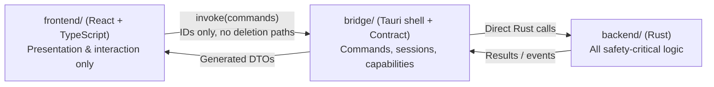

# Sweeper — Implementation Plan

> Status: Approved for autonomous execution (Phases 0–6 via sub-agents). No implementation code has been written yet.
> Domain terms are defined in [GLOSSARY.md](../GLOSSARY.md) (`Target`, `Allowlist`, `Protected Path`, `Custom Path`, `Knowledge Base`, `Risk`, `Safe`, `Caution`, `Unknown`, `Protected`, `Tier`, `Scan`, `Preview`, `Clean`, `Analyzer`, `Minimum Age`, `Skipped`, `Link Point`).
> Architectural decisions: [ADR 0001](./adr/0001-deny-by-default-allowlist.md), [ADR 0002](./adr/0002-three-part-separation.md), [ADR 0003](./adr/0003-handle-based-removal.md).
> Orchestration & delegation policy: [DELEGATION.md](./DELEGATION.md).

---

## 1. Goal and Scope

**Goal:** A single-button Windows desktop application that discovers reclaimable space on drive `C:`, explains every item (what it is, its size, and its `Risk`), and removes only what the user confirms. **Safety and integrity take strict priority over features and speed.**

**In v1:**
- `Scan` → `Preview` → `Clean` for `Tier` 1, 2, and 3 `Target`s (`Tier` 3 disabled by default).
- Read-only `Analyzer` explaining each folder's purpose and `Risk`, allowing selection of removable items into `Preview`.
- Advanced settings: `Custom Path`s, `Tier` toggles, "Allow deleting unknown folders", and `Minimum Age` override.
- Permanent deletion (bypasses Recycle Bin), with a per-operation log.
- English UI. Standalone `.exe`, running without elevation (no UAC prompt) by default.

**Explicitly out of v1:**
- Compacting or shrinking WSL/Docker `.vhdx` files (displayed in `Analyzer` only; never deleted).
- Direct NTFS MFT reading to accelerate `Analyzer` (requires elevation; deferred to a later stage).
- Background daemons or scheduled tasks. Every operation starts from an explicit user action.
- Arabic UI.

---

## 2. Architecture: Three Separated Parts

The three parts are developed and tested independently and communicate exclusively through a typed **Contract** with auto-generated TypeScript bindings so cross-layer drift fails at build time.



**Planned workspace layout** (not yet created; currently only `GLOSSARY.md`, `.gitignore`, `docs/`, and local git-ignored `reference/` exist):

```text
Sweeper/
├─ Cargo.toml                  Workspace combining backend + bridge
├─ rust-toolchain.toml         Pinned Rust toolchain (1.99.1)
├─ clippy.toml  deny.toml      Lint rules (ban deletion outside remover) & dependency audit
├─ backend/                    Part 1: Pure Rust backend (no UI)
│  ├─ sweeper-winfs/           Raw Windows NTFS operations (all unsafe lives here)
│  ├─ sweeper-knowledge/       Allowlist + Protected Paths + Knowledge Base (data + types)
│  ├─ sweeper-core/            Logic: validation, Scan, Analyzer, Remover, Journal, Settings
│  └─ sweeper-testkit/         Test harness: isolated sandbox, canaries, junction helpers
├─ bridge/                     Part 2: Typed bridge
│  ├─ sweeper-contract/        DTOs, error types, command signatures (single source of truth -> TS)
│  └─ sweeper-desktop/         Tauri shell: IPC handlers, in-memory sessions, capabilities, CSP
├─ frontend/                   Part 3: Vite + React + TypeScript
│  └─ src/contract/            Auto-generated bindings (read-only; never edit manually)
└─ docs/                       Implementation plan, delegation policy, and ADRs
```

**Dependency direction (strictly enforced):**
- `sweeper-winfs` ← `sweeper-core` → `sweeper-knowledge`
- `sweeper-contract` is standalone (defines its own DTOs; mapping happens in `sweeper-desktop`).
- `sweeper-desktop` → `sweeper-core` + `sweeper-contract`
- `frontend` → generated contract only.

### Module Responsibilities & Hard Constraints

| Crate / Module | Responsibility | Hard Constraint |
|---|---|---|
| `sweeper-winfs` | Handle-based open/enumerate/delete on NTFS, reparse tag inspection, `GetFinalPathNameByHandle` | Sole crate permitted to contain `unsafe` (recommended Win32 binding: `windows-sys`, see §10). Zero knowledge of `Allowlist` or `Risk`. |
| `sweeper-knowledge` | `Target` and `Protected Path` definitions, embedded `allowlist.toml`, parser & linter | Zero filesystem I/O. |
| `sweeper-core` | `paths` (validated path types), `policy`, `scanner`, `analyzer`, `remover`, `journal`, `settings` | `#![forbid(unsafe_code)]`. **`remover` is the sole module permitted to invoke `sweeper-winfs` deletion primitives.** |
| `sweeper-contract` | Command inputs, outputs, events, and error shapes | `u64` byte counts and file IDs serialize as decimal `string` in TypeScript (see §5). |
| `sweeper-desktop` | Command registration, in-memory `ScanSession` store, `preview_token` enforcement | Zero deletion logic. |
| `frontend` | UI rendering and user interaction | Zero `fs` or `shell` Tauri plugins. Never holds or submits deletion paths. |

---

## 3. Safety Model (Highest Priority)

> **Engineering honesty:** No file-deletion program can truthfully claim "100% impossible to err". What we guarantee is **independent defense-in-depth layers that must all fail simultaneously** for an unauthorized deletion to occur, backed by CI gates that block non-compliant code from ever reaching the executable.

### 3.1 Defense-in-Depth Layers (Ordered)

1. **Deny-by-default:** Every deletion must match a built-in `Allowlist` `Target` or an explicitly validated `Custom Path` (ADR 0001).
2. **Hard `Protected Path`s:** Two-tier protection (Subtree-Protected and Container-Protected, §3.4) enforced in `sweeper-core` and non-disableable from the UI.
3. **Parse, don't validate:** `remover` accepts only `ValidatedItem`, a type with no public constructor. Raw strings cannot reach deletion APIs.
4. **ID-only deletion IPC:** Frontend submits `Scan` item IDs stored in a backend `ScanSession`, never deletion paths. The only commands accepting a path are `validate_custom_path`, `update_settings` (for `Custom Path`s), and the optional `Analyzer` `root`; none of them accepts a deletion path.
5. **Single-use `preview_token`:** `execute_clean` requires a token issued by `preview_clean`, bound to a hash of the selected item IDs, valid for 10 minutes (within a `ScanSession` valid for 15 minutes). No `Clean` without `Preview`.
6. **Moment-of-deletion re-validation:** Every item is re-checked on the opened handle itself: `Allowlist` match, `Protected Path` exclusion, final path containment within `Target` root, reparse tag check, and `Minimum Age`.
7. **Handle-based deletion, never path-based** (ADR 0003): Eliminates the TOCTOU symlink/junction swap class of bugs (cf. CVE-2022-21658).
8. **Runtime circuit breakers:** `Clean` aborts immediately if actual deleted bytes exceed **120%** of the `Preview` estimate, or if any resolved handle escapes its `Target` root. Any `panic` inside `remover` aborts the process (`panic = "abort"`).
9. **Write-ahead journal:** Intent is written and flushed to the log before each deletion batch so an audit trail survives even if the process is terminated mid-run.

### 3.2 `Target` Rules (Enforced at Build Time)

- Every standard `Target` root = a Windows Known Folder (resolved via `SHGetKnownFolderPath`, never raw text env expansion) + a fixed relative subpath. Every resolved Known Folder root must pass the `Protected Path` and minimum depth ≥ 3 checks (because Known Folders themselves can be redirected).
- `**` globs are forbidden. At most one `*` wildcard in an intermediate segment (e.g., `Profile *`), never in the final segment.
- No `Target` may point at a browser profile root; paths must explicitly name cache subfolders (`Cache`, `Code Cache`, `GPUCache`).
- Every `Target` defines: `id`, `tier`, `risk`, `description`, `scope` (contents only), and `min_age_hours`.
- **`%TEMP%` redirection guard:** The primary `user-temp` `Target` is anchored to Known Folder `FOLDERID_LocalAppData\Temp`. A separate conditional `redirected-temp` `Target` inspects `%TEMP%` via Win32 (`GetEnvironmentVariableW` + handle canonicalization) only if it differs from `FOLDERID_LocalAppData\Temp`, and automatically disables itself if `%TEMP%` resolves to any `Protected Path` (container or subtree), has path depth < 3 segments, or traverses a `Link Point`.

### 3.3 `Link Point` and Reparse Point Policy

| Reparse / Link Type | Behavior |
|---|---|
| Symlink / Junction (`Link Point`) | Never traversed. Only the link entry itself inside a `Target` may be removed; target contents are untouched. |
| Cloud placeholders (OneDrive / `cldflt` tags) | **Always `Skipped`.** Deleting synced placeholders propagates deletions to the cloud. Never trigger hydration. |
| Other reparse tags (`AppExecLink`, `WOF`, etc.) | **Always `Skipped`.** |
| Hard link | Unlinks the directory entry only (standard NTFS behavior); other hard-linked paths remain intact. |

### 3.4 `Protected Path`s (Initial Set — Expanded via Tests)

All matching resolves the opened handle via `GetFinalPathNameByHandle` and compares case-insensitively on canonical identity, never on raw input strings (closing 8.3 short-name aliases `PROGRA~1`, trailing dots/spaces, and `\\?\` prefix tricks).

1. **Subtree-Protected Paths (path or any descendant unconditionally blocked across `Allowlist`, `Custom Path`s, `Analyzer`, and `Clean` — zero exceptions):**
   - `C:\Windows\System32`, `C:\Windows\WinSxS`, `C:\Windows\SysWOW64`, `C:\Windows\Boot`, `C:\Windows\Fonts`, `C:\Windows\servicing`
   - `Program Files`, `Program Files (x86)`
   - User data folders: `Desktop`, `Documents`, `Downloads`, `Pictures`, `Videos`, `Music`, OneDrive sync roots
   - Secrets & VCS: `.ssh`, `.gnupg`, `.aws`, `.kube`, `.docker` (config), any directory named `.git`
   - OS internals: `System Volume Information`, `pagefile.sys`, `hiberfil.sys`, `swapfile.sys`, `NTUSER.DAT*`, `Recovery`
   - **Rule:** Blocked if `resolved == protected` or `protected` is an ancestor of `resolved`. Furthermore, no `Target` root or `Custom Path` may be an ancestor of any Subtree-Protected Path. Build-time linter fails if any `Allowlist` `Target` overlaps a Subtree-Protected Path.

2. **Protected Container Roots (exact canonical identity protected; non-Allowlist descendants blocked from selection):**
   - Any drive root (`C:\`, `D:\`, etc.)
   - `C:\Windows` root
   - `C:\Users` root and any user profile root (`C:\Users\<name>`)
   - `ProgramData` root (`C:\ProgramData`)
   - Browser `User Data` and profile roots (e.g., Chrome/Edge `User Data`, `Default`, `Profile *`)
   - **Rule:** Cannot be deleted or selected by `Custom Path` or `Analyzer`. Only explicitly enumerated, build-time-linted `Allowlist` `Target` subfolders underneath them (such as `FOLDERID_LocalAppData\Temp`, `C:\Windows\Temp`, `C:\ProgramData\Package Cache`, or browser `Cache`/`Code Cache`/`GPUCache` leaf folders) are cleanable.

---

## 4. Workflows

### `Scan`
1. Parse the embedded `allowlist.toml` and resolve Known Folders (plus `%TEMP%` guard evaluation).
2. For each enabled `Target`: enumerate via handles (never following `Link Point`s), summing total bytes, file counts, and items exceeding `Minimum Age`.
3. Store an in-memory `ScanSession` (TTL: **15 minutes**; invalidated immediately if `update_settings` modifies scan-affecting fields) holding items (`id`, `target_id`, path, file identity = volume serial + file ID, size, mtime).
4. Return to UI: `id`, `target_id`, description, `Risk`, size, count. Path is for display only.

### `Preview` → `Clean`
1. User toggles selection; `preview_clean(session_id, item_ids, confirmations?)` verifies session validity and typed confirmations (if required), then returns a per-`Target` breakdown + single-use `preview_token` (TTL: **10 minutes**, bounded by `ScanSession` expiry).
2. If selection includes `Custom Path` or `Unknown` items, typed confirmation text is required and verified in Rust before issuing `preview_token`.
3. `execute_clean(preview_token)`: verifies session + single-use token, then for each item → open handle (`FILE_FLAG_OPEN_REPARSE_POINT`) → run Section 3.1(6) checks → flush intent to journal → delete via `FileDispositionInfoEx` (POSIX semantics) → log outcome (`deleted` / `Skipped` + reason).
4. Return summary: bytes freed, `Skipped` count, and reasons.

### `Analyzer` (Read-Only)
- Walks the drive using parallel `FindFirstFileEx` (`FIND_FIRST_EX_LARGE_FETCH`), never following `Link Point`s, returning aggregated folder sizes as an expandable tree (virtualized in UI).
- Known folders are annotated from the `Knowledge Base` with description and `Risk` (`Safe`, `Caution`, `Unknown`, `Protected`).
- Selection for deletion is permitted for `Safe`, for `Caution` when its `Tier` is enabled, and for `Unknown` only when "Allow deleting unknown folders" is enabled and confirmed (subject to `Custom Path` and `Protected Path` rules). `Protected` items are never selectable.
- No direct delete button: selected items feed into the standard `Preview` → `Clean` pipeline.

### Settings (`%APPDATA%\Sweeper\settings.json`)
- Stores: enabled `Tier`s, `Minimum Age` (default 24h; user-configurable e.g. 10h or 0h with warning), "Allow deleting unknown folders", and `Custom Path`s.
- Parsed and validated on every load; invalid or tampered values fall back to safe defaults. `Protected Path`s are never stored in or overridable via settings.
- `Custom Path`s must pass: exists on disk, absolute path without `..`, neither a Subtree-Protected Path nor a Protected Container Root, contains no `Protected Path` descendant, depth ≥ 3 segments, deletes contents only (keeps root folder), explicit typed confirmation, and **no fallback to parent if missing**. Checked both on add and at `Clean` time.

### Log (`%LOCALAPPDATA%\Sweeper\logs\`)
- JSON-lines per operation (intent, outcome, path, size, timestamp). Rotated to keep the last 30 log files.

---

## 5. Typed Contract (IPC Surface)

| Command | Input | Output |
|---|---|---|
| `start_scan` | `tiers?` | `session_id` + progress events |
| `get_scan_results` | `session_id` | Item list (display metadata; no submitted paths) |
| `preview_clean` | `session_id`, `item_ids[]`, `confirmations?` | Breakdown + `preview_token` |
| `execute_clean` | `preview_token` | Progress events + final summary |
| `start_analyzer` | `root?` | Progress events + tree nodes |
| `explain_item` | `item_id` | Description + `Risk` |
| `get_settings` / `update_settings` | Settings DTO | Validated settings DTO |
| `validate_custom_path` | `path` | Verdict + reason (no side effects) |
| `list_logs` / `read_log` | Log ID | Log metadata / entries |

- **Version pins:** Tauri `2.x` (`tauri` pinned in `Cargo.lock` and built with `--locked`) and `tauri-specta = "=2.0.0-rc.29"` (verify exact compatible patch/RC at Phase 2 lock).
- **Type generation & serialization:** All DTOs and command signatures live in `sweeper-contract` and export to `frontend/src/contract/` via `tauri-specta`. Generated TS files are committed, and CI fails on any diff. All `u64` byte counts and file IDs serialize as decimal `string` in TypeScript (`specta` string serialization) to avoid JSON `BigInt` incompatibility and JS `Number.MAX_SAFE_INTEGER` precision loss.
- **Capabilities & Isolation:** Every command is declared in the Tauri app manifest with explicit scoped permissions; no `fs` or `shell` plugins.
- **Browser hardening:** Strict CSP (`default-src 'self'`, no `'unsafe-eval'`, no `'unsafe-inline'`), `security.freezePrototype: true`, and Tauri **Isolation pattern** for IPC validation.
- **Errors:** Serialize to structured enum variants without leaking internal paths or stack traces.

---

## 6. Testing Strategy and Security Gates

### 6.1 Invariants
- **Isolated Sandbox with Sentinel:** Every deletion test runs inside a per-test temp sandbox containing a sentinel file at its root. The harness panics if any target root lacks the sentinel ancestor. **No test ever touches real user or system paths.**
- **Canary Harness:** Every deletion test seeds a "must-survive" canary tree outside the target; post-run (even after failure or panic), all canary files must exist with identical hashes.
- **Dual-privilege runs:** Integration tests execute both as standard user and as Administrator (since symlink creation and privilege/ACL behavior differ).

### 6.2 Layers & Gates

**A. Static Gates (every commit, zero execution):**
- `clippy::disallowed_methods`: bans `std::fs::remove_*` everywhere in `backend/` and `bridge/` (including inside `core::remover`), and bans `sweeper-winfs` deletion primitives everywhere except a single audited `#[allow]` inside `core::remover`.
- CI grep gate: fails if `std::fs::remove_*` appears anywhere in production code, or if any `sweeper-winfs` deletion symbol appears outside `core::remover` / `sweeper-winfs`.
- `#![forbid(unsafe_code)]` on all crates except `sweeper-winfs`; every `unsafe` block requires a `// SAFETY:` comment; `cargo geiger` tracks unsafe count.
- `cargo deny` (licenses + advisories), `cargo audit`, `pnpm audit`; all builds run with `--locked`.
- Allowlist linter: rejects `**`, wildcard in final segment, overlap with any Subtree-Protected Path, Protected Container Roots targeted directly, duplicates, or browser profile roots.
- Tauri capability & CSP audit against an expected snapshot.
- Frontend: TypeScript `strict: true`; ESLint forbids `eval` and `dangerouslySetInnerHTML`.

**B. Unit + Property + Mutation Tests:**
- Core property (`proptest`): *For any generated path string, if canonical normalization places it under a Subtree-Protected Path or matches a Protected Container Root, `Custom Path` / `Analyzer` validation rejects it.* Tested across millions of inputs.
- `cargo-fuzz` targets on allowlist parser, path validator, and journal reader.
- `cargo-mutants` on `core::policy` and `core::paths`: **mutation score ≥ 95% required to merge**.

**C. Adversarial Path Corpus (table-driven):**
`..` and `.`, mixed `/` and `\`, `\\?\`, `\\.\`, `\??\`, `\\?\GLOBALROOT\...`, UNC paths, drive-relative paths (`C:foo`), trailing spaces and dots, 8.3 short names (`PROGRA~1`), `:` (Alternate Data Streams), reserved device names (`CON`, `NUL`, `COM1`, superscripts), Unicode normalization/full-width tricks, mixed casing (`c:\WINDOWS`), paths > 260 chars, empty/root/null-byte inputs, prefix confusion (`C:\Windows` vs `C:\Windows.old` vs `C:\WindowsApps`).

**D. Real NTFS Integration Tests (inside Sandbox):**
- Junction or symlink inside `Target` pointing outside → canary intact, link entry removed.
- **TOCTOU race:** background thread swaps a directory for a junction during `Clean` (1000+ iterations) → all canaries survive.
- `Target` root or ancestor swapped to a junction → rejected.
- Hard link to an outside file → outside file intact.
- Locked files (opened without `FILE_SHARE_DELETE`) → `Skipped`, remaining eligible items cleaned.
- Read-only / hidden / system files; files newer than `Minimum Age`; exact boundary timestamp; future mtime (treated as recent / `Skipped`).
- Paths > 260 chars; 1000-level deep tree (iterative walker, zero stack overflow); reserved names via `\\?\`; trailing dots; ADS streams; Arabic & emoji filenames; per-directory case-sensitive filenames (`fsutil file setCaseSensitiveInfo`).
- Volume mount point to another drive → treated as `Link Point`, never traversed.
- Reparse tag matrix: every non-symlink/mount-point tag (including mocked cloud placeholder tags) → `Skipped`.
- **Missing `Custom Path`:** zero deletions, parent directory untouched.
- `%TEMP%` (or Known Folder) redirected to drive root / profile root / `Documents` → `redirected-temp` (or affected Known-Folder `Target`) automatically disabled.
- Mid-`Clean` process termination + restart → no corruption, idempotent recovery.

**E. Real-Machine `Allowlist` Verification (Read-Only):**
- Every `Target` resolves cleanly; zero overlap with Subtree-Protected Paths, zero Protected Container Roots targeted directly, zero `Link Point`s, zero unintended overlap between `Target`s, zero browser profile roots.

**F. Bridge & IPC Tests:**
- Unknown IDs, expired `ScanSession` (> 15 min or invalidated by `update_settings`), double `execute_clean`, `Clean` without `Preview`, tampered `preview_token`, expired token (> 10 min) → all rejected.
- Serde fuzzing on command payloads; exact command surface assertion against manifest.

**G. Frontend Tests:**
- Vitest component tests + **Playwright E2E against a mock/sandbox backend** (never touches real `C:`).
- Typed confirmation flows (`Custom Path` / `Unknown`), accessibility (a11y), and error states.

**H. Release Gates (all must be green):**
1. Gates A–G pass.
2. `cargo-mutants` score ≥ 95% on `policy` and `paths`.
3. **Scan-only** run on the real target machine, with user review of sizes and classifications before any real `Clean`.
4. First real `Clean` limited to `user-temp` only, followed by log inspection.
5. Signed `.exe` + SHA-256 checksums.

> **Primary security references (verify implementation details directly against upstream docs during Phases 1–3):** Google Project Zero *"The Definitive Guide on Win32 to NT Path Conversion"*, Microsoft Learn *"Naming Files, Paths, and Namespaces"*, RustSec Advisory `RUSTSEC-2023-0018`, `CVE-2022-21658`, and Tauri v2 Security documentation.

---

## 7. Build Phases

Each phase delivers working, tested code passing its gates. **No real deletion code or capability exists before Phase 3.**

### Phase 0: Foundation (before any feature)
- Workspace layout, `rust-toolchain.toml`, `clippy.toml`, `deny.toml`, CI running Static Gates (A).
- `sweeper-testkit`: sandbox with sentinel, canary harness, junction/symlink helpers.
- **Exit criterion:** CI passes and deliberately adding `std::fs::remove_file` anywhere in `backend/` or `bridge/` fails CI.

### Phase 1: Read-Only Core
- `sweeper-winfs`: handle open, enumerate, `GetFinalPathNameByHandle`, reparse inspection (no delete primitives yet).
- `sweeper-knowledge`: `allowlist.toml` (Tiers 1 & 2) + `Protected Path`s + build-time linter.
- `sweeper-core`: `paths` + `policy` + `scanner`, plus a temporary dev-only scan reporter binary to inspect the real machine safely (read-only) and an optional Winapp2.ini candidate-extraction script outputting a `.md` review report (reference only, never auto-executed).
- **Exit criterion:** Gates B, C, E pass; user reviews real machine `Scan` report.
- **Primary risk:** Path canonicalization edge cases — concentrate tests here.

### Phase 2: UI (`Scan` + `Preview`)
- `sweeper-contract` + `sweeper-desktop` (read-only commands) + `frontend` (`Scan` results + `Preview` breakdown).
- `tauri-specta` TS generation, capabilities, strict CSP, Isolation pattern.
- **Exit criterion:** Gates F, G pass for read-only commands; UI displays real `Scan` results. `execute_clean` does not exist yet.

### Phase 3: `Remover` + `Clean`
- `sweeper-winfs`: handle-based delete (`FileDispositionInfoEx`). `core::remover` + `journal` + `Minimum Age` + 120% circuit breaker.
- `preview_token` + `execute_clean`.
- **Exit criterion:** All Gate D tests pass (especially TOCTOU race and canaries), mutation score ≥ 95%, first real `Clean` verified on `user-temp` only.
- **Primary risk:** Highest-risk phase; keep isolated from unrelated features.

### Phase 4: `Analyzer`
- Parallel fast directory walk, virtualized UI tree, `Knowledge Base` explanations and `Risk` badges.
- Selection routed into standard `Preview` flow.
- **Exit criterion:** `Analyzer` accounts for uncategorized space on `C:` beyond built-in `Allowlist` `Target`s, and all existing safety/deletion tests remain green.

### Phase 5: Advanced Settings + `Tier` 3
- `Custom Path`s + typed confirmation, `Tier` toggles, "Allow deleting unknown folders", `Minimum Age` override.
- `Tier` 3 `Target`s: `Recycle Bin` (opt-in permanent empty), stale Rust `target/` (requires sibling `Cargo.toml` unmodified for N days), stale `node_modules` (requires sibling lockfile), WSL/Docker `.vhdx` (**display only**).
- **Exit criterion:** All `Custom Path` / missing-path / tampered-settings tests pass without weakening invariants.

### Phase 6: Packaging & Optional Elevation
- `.exe` / installer packaging, code signing, optional "Run as administrator" flow (for `C:\Windows\Temp`, Windows Update cache, `Prefetch`).
- When elevated, **only elevation-requiring `Target`s are unlocked**, with dedicated safety gates.
- **Exit criterion:** All Release Gates (H) green.

---

## 8. Initial `Target` Candidates

| Tier | Target | Risk | Notes |
|---|---|---|---|
| 1 | `FOLDERID_LocalAppData\Temp` (contents) | `Safe` | Primary `user-temp` `Target` (plus guarded `redirected-temp` if `%TEMP%` differs) |
| 1 | `CrashDumps` & `Microsoft\Windows\WER` | `Safe` | Local user crash reports and error dumps |
| 1 | `INetCache` & Thumbnail cache | `Safe` | Automatically regenerated by Windows/Shell |
| 2 | `npm-cache` (`%LOCALAPPDATA%\npm-cache`) | `Safe` | Package manager download cache |
| 2 | `~\.gradle\caches` (subfolder only) | `Caution` | Redownloaded on next Gradle build |
| 2 | `.cargo\registry\cache` | `Safe` | Redownloaded crate archives only |
| 2 | Chrome/Edge caches (`Default\Cache`, `Code Cache`, `GPUCache`) | `Safe` | Explicit leaf subfolders only; `User Data` and profile roots are Container-Protected |
| 2 | VS Code caches (`Cache`, `CachedData`) | `Safe` | `User` & `workspaceStorage` are `Unknown` (never auto-cleaned) |
| 2 | `~\.nuget`, `NuGet`, `pip`, `JetBrains` caches | `Caution` | Redownloaded on build; may delay IDE/tool startup |
| 3 | Recycle Bin | `Caution` | Permanently empties user's Recycle Bin undo buffer; opt-in via `Tier` 3 |
| 3 | `ProgramData\Package Cache` | `Caution` | Affects installer repair/uninstall; requires admin (Phase 6) |
| 3 | Stale `target/` & `node_modules` | `Caution` | Gated by Phase 5 project-staleness rules |
| — | `Local\Programs`, `.rustup`, `Packages` | `Protected` / `Unknown` | Display only in `Analyzer` |

Entries above require review before entering `allowlist.toml`. Any newly discovered candidates are written to a `.md` review report first.

---

## 9. Standing Technical Defaults (Approved)

1. Session & token lifetimes: `ScanSession` TTL is **15 minutes** (invalidated immediately on scan-affecting `update_settings`); `preview_token` TTL is **10 minutes** (single-use, bounded by session expiry).
2. **120% circuit breaker:** `Clean` aborts if actual deleted bytes exceed 120% of the `Preview` estimate.
3. Cloud placeholders are **always `Skipped`**, regardless of `Minimum Age`.
4. WSL/Docker `.vhdx` files: **display only**, never deleted.
5. Admin mode relaunches the app elevated and enables only admin-required `Target`s (deferred to Phase 6 due to elevated risk).
6. Log retention: last **30** log files.
7. `settings.json` is treated as untrusted input and re-validated on every load.
8. Test sandbox refuses to run without its root sentinel file.
9. Product name is **Sweeper**; crate prefix is `sweeper-`; no crates.io publication planned.

---

## 10. Settled Technical Decisions

- **`windows-sys` crate:** Selected over `windows` (lighter dependency surface, sufficient for Win32 handle APIs).
- **Known Folders enum:** Closed enum in `sweeper-knowledge` mapping to `FOLDERID_*` constants in `sweeper-winfs`.
- **Full-drive `Analyzer` speed on `C:`:** Use parallel `FindFirstFileEx` (`FIND_FIRST_EX_LARGE_FETCH`) in Phase 4 and benchmark; defer any optional elevated MFT acceleration to post-v1 unless Phase 4 benchmarks exceed ~2 minutes and require reopening.
